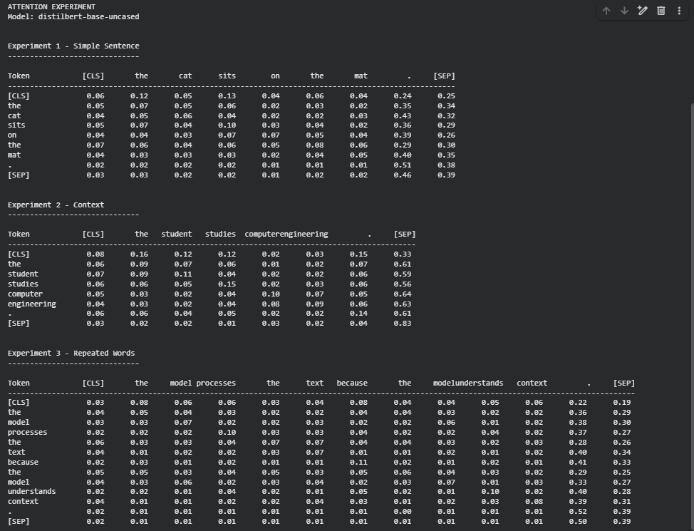

# Attention Experiment

A Python-based attention experiment developed to explore how a pretrained Transformer model distributes attention across tokens.

This project was created to reinforce Python programming and natural language processing concepts through practical development.

The experiment uses the `distilbert-base-uncased` model from Hugging Face Transformers and examines attention scores between tokens in different sentences.

## Features

- Tokenize input text
- Display tokens processed by the Transformer model
- Extract attention weights from the model
- Analyze attention scores between tokens
- Average attention across attention heads
- Examine attention in a simple sentence
- Examine attention in a contextual sentence
- Examine attention between repeated words

## Technologies Used

- Python
- Hugging Face Transformers
- PyTorch
- DistilBERT (`distilbert-base-uncased`)
- Visual Studio Code
- Google Colab

## Project Structure

```text
Attention-Experiment/
├── README.md
├── requirements.txt
├── attention_experiment.py
└── screenshot/
    └── attention-experiment-output.png
```

## How to Run

### 1. Install the Required Dependencies

```bash
pip install -r requirements.txt
```

### 2. Run the Experiment

Open `attention_experiment.py` in Google Colab and run the code.

The project was developed using Visual Studio Code and executed using Google Colab.

## Screenshot

### Attention Experiment Output



## Related Learning

This project was developed as part of my learning journey with *Hands-On Large Language Models* by Jay Alammar and Maarten Grootendorst.

The project was developed alongside my study of the Transformer and attention concepts covered in the book, allowing me to apply these concepts through a practical experiment.

The experiment focuses on how a pretrained Transformer model distributes attention across tokens and how attention patterns can vary depending on the input sentence.

## Author

**Silva Ibrahim**  
Computer Engineering Student

## License

This project is licensed under the MIT License.