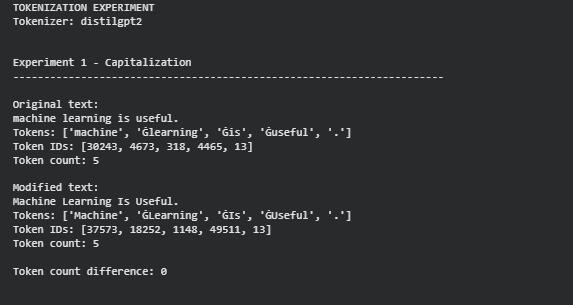
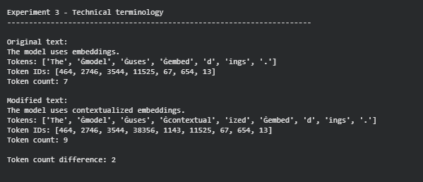
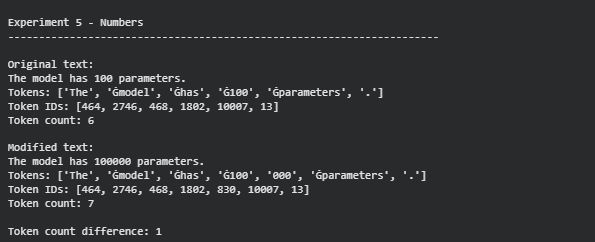

# Tokenization Experiment

A Python-based tokenization experiment developed to explore how a pretrained tokenizer processes text.

This project was created to reinforce Python programming and natural language processing concepts through practical development.

The experiment uses the `distilgpt2` tokenizer from Hugging Face Transformers and compares original and modified versions of different sentences to observe how changes in text affect tokens, token IDs, and token counts.

## Features

- Compare original and modified text
- Display generated tokens
- Display token IDs
- Compare token counts
- Calculate token count differences
- Experiment with capitalization
- Experiment with punctuation
- Experiment with technical terminology
- Experiment with word length
- Experiment with numbers

## Technologies Used

- Python
- Hugging Face Transformers
- GPT-2 Tokenizer (`distilgpt2`)
- Visual Studio Code
- Google Colab

## Project Structure

```text
Tokenization-Experiment/
├── README.md
├── requirements.txt
├── tokenization_experiment.py
└── screenshots/
    ├── capitalization-experiment.png
    ├── technical-terminology-experiment.png
    └── numbers-experiment.png
```

## How to Run

### 1. Install the Required Dependency

```bash
pip install -r requirements.txt
```

### 2. Run the Experiment

Open `tokenization_experiment.py` in Google Colab and run the code.

The project was developed using Visual Studio Code and executed using Google Colab.

## Screenshots

### Capitalization Experiment



### Technical Terminology Experiment



### Numbers Experiment



## Related Learning

This project was developed as part of my learning journey with *Hands-On Large Language Models* by Jay Alammar and Maarten Grootendorst.

The project was developed alongside my study of the tokenization concepts covered in the book, allowing me to apply these concepts through a practical experiment.

The experiment focuses on how pretrained tokenizers process different types of text and how changes in text can affect tokenization.

## Author

**Silva Ibrahim**  
Computer Engineering Student

## License

This project is licensed under the MIT License.