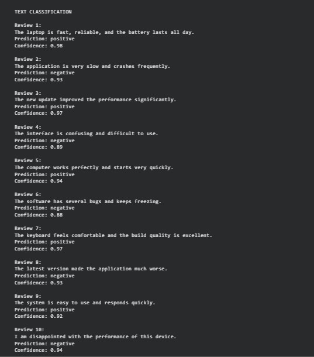
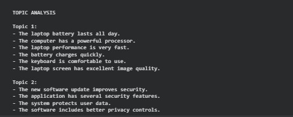

# Text Classification & Topic Analysis System

A Python-based Natural Language Processing project developed to explore text classification and topic analysis using pretrained models and text embeddings.

This project was created to reinforce Python programming and natural language processing concepts through practical development.

The project consists of two related modules: text classification and topic analysis.

## Features

- Classify text based on sentiment
- Display prediction confidence scores
- Generate text embeddings
- Group semantically similar texts
- Analyze text clusters
- Experiment with different technology-related texts

## Technologies Used

- Python
- Hugging Face Transformers
- Sentence Transformers
- HDBSCAN
- PyTorch
- Pretrained Transformer Models
- Visual Studio Code
- Google Colab

## Project Structure

```text id="2v9y8m"
Text-Classification-Topic-Analysis-System/
├── README.md
├── requirements.txt
├── text_classification.py
├── topic_analysis.py
└── screenshots/
    ├── sentiment-classification.png
    └── topic-analysis.png
```

## How to Run

### 1. Install the Required Dependencies

```bash id="8x5g0k"
!pip install -r requirements.txt
```

### 2. Run the Text Classification Module

```bash id="3h0n5r"
!python text_classification.py
```

### 3. Run the Topic Analysis Module

```bash id="q7v1cs"
!python topic_analysis.py
```

The project was developed using Visual Studio Code and executed using Google Colab.

## Screenshots

### Text Classification



### Topic Analysis



## Related Learning

This project was developed as part of my learning journey with *Hands-On Large Language Models* by Jay Alammar and Maarten Grootendorst.

The project was developed alongside my study of the text classification, text embeddings, and clustering concepts covered in the book, allowing me to apply these concepts through practical experiments.

The project focuses on classifying text based on sentiment and grouping semantically similar texts using text embeddings and clustering techniques.

## Author

**Silva Ibrahim**  
Computer Engineering Student

## License

This project is licensed under the MIT License.