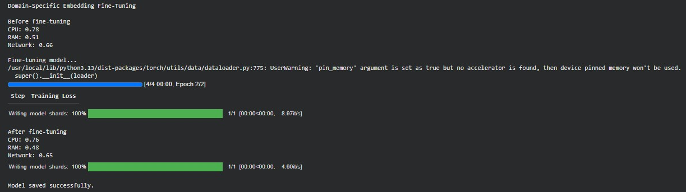

# Domain-Specific Embedding Fine-Tuning

A Python-based experiment developed to explore domain-specific fine-tuning of a pretrained Sentence Transformer embedding model.

The experiment uses Computer Engineering-related sentence pairs and compares their semantic similarity before and after fine-tuning.

## Features

- Use a pretrained Sentence Transformer model
- Create a small Computer Engineering-related dataset
- Fine-tune the embedding model using contrastive learning
- Generate sentence embeddings
- Calculate cosine similarity between text pairs
- Compare similarity scores before and after fine-tuning
- Save the fine-tuned model

## Technologies Used

- Python
- Hugging Face Sentence Transformers
- Hugging Face Datasets
- PyTorch
- Embedding Models
- Contrastive Learning
- Cosine Similarity
- Visual Studio Code
- Google Colab

## Project Structure

```text id="7h3m2p"
Domain-Specific-Embedding-Fine-Tuning/
├── README.md
├── requirements.txt
├── embedding_fine_tuning.py
└── screenshot/
    └── fine-tuning-output.png
```

## How to Run

### 1. Install the Required Dependencies

```bash id="9w2k4n"
!pip install -r requirements.txt
```

### 2. Run the Embedding Fine-Tuning Experiment

```bash id="4p8x1v"
!python embedding_fine_tuning.py
```

The project was developed using Visual Studio Code and executed using Google Colab.

## Screenshot

### Fine-Tuning Output



## Related Learning

This project was developed as part of my learning journey with *Hands-On Large Language Models* by Jay Alammar and Maarten Grootendorst.

It was developed while studying Chapter 10, which focuses on embedding models and fine-tuning techniques.

The experiment provided practical experience with domain-specific embedding fine-tuning, contrastive learning, and semantic similarity evaluation.

## Author

**Silva Ibrahim**  
Computer Engineering Student

## License

This project is licensed under the MIT License.