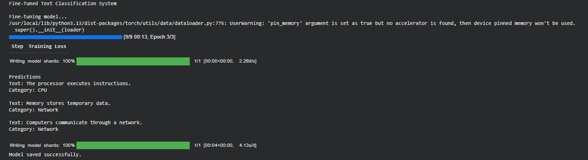

# Fine-Tuned Text Classification System

A Python-based experiment developed to explore fine-tuning a pretrained language model for domain-specific text classification.

The experiment uses Computer Engineering-related sentence data and fine-tunes a pretrained DistilBERT model to classify texts into three categories: CPU, RAM, and Network.

## Features

- Use a pretrained DistilBERT model
- Create a small Computer Engineering-related dataset
- Fine-tune the model for text classification
- Tokenize input texts using a pretrained tokenizer
- Classify new texts into predefined categories
- Test the fine-tuned model with new sentences
- Save the fine-tuned model and tokenizer

## Technologies Used

- Python
- Hugging Face Transformers
- Hugging Face Datasets
- DistilBERT
- PyTorch
- Text Classification
- Fine-Tuning
- NumPy
- Visual Studio Code
- Google Colab

## Project Structure

```text id="k7p2md"
Fine-Tuned-Text-Classification-System/
├── README.md
├── requirements.txt
├── text_classification.py
└── screenshot/
    └── classification-output.png
```

## How to Run

### 1. Install the Required Dependencies

```bash id="v4n8qx"
!pip install -r requirements.txt
```

### 2. Run the Experiment

```bash id="c3m6zt"
!python text_classification.py
```

The project was developed using Visual Studio Code and executed using Google Colab.

## Screenshot

### Classification Output



## Related Learning

This project was developed as part of my learning journey with *Hands-On Large Language Models* by Jay Alammar and Maarten Grootendorst.

It was developed while studying Chapter 11, which focuses on fine-tuning representation models for classification.

The experiment provided practical experience with dataset preparation, tokenization, model fine-tuning, and domain-specific text classification using a pretrained DistilBERT model.

## Author

**Silva Ibrahim**  
Computer Engineering Student

## License

This project is licensed under the MIT License.